# SBA loan lifecycle and workflow requirements

**Reference date:** October 28, 2026. Validate the currently effective SBA SOP, notices, CFR, lender policy, and state/federal law before operational use. This document is a product/process baseline, not legal advice or an SBA approval.

## Regulator and program framing

The SBA administers the 7(a) and 504 loan programs and issues lender operating procedures. The SEC's mission concerns investor protection, fair and orderly securities markets, and capital formation; it is **not the primary policymaker for ordinary SBA loan underwriting**. Securities laws may apply to a separate capital-raising or securities offering activity, which needs its own legal analysis.

Primary reference starting points:
- SBA SOP 50 10 (Lender and Development Company Loan Programs): https://www.sba.gov/document/sop-50-10-lender-development-company-loan-programs
- SBA Lender guidance: https://www.sba.gov/sba-lenders/
- SBA 7(a): https://www.sba.gov/funding-programs/loans/7a-loans
- SBA 504: https://www.sba.gov/funding-programs/loans/504-loans
- SBA SOP 50 57 (7(a) servicing and liquidation): https://www.sba.gov/document/sop-50-57-7a-loan-servicing-liquidation
- 13 CFR 120.150 (creditworthiness and repayment): https://www.ecfr.gov/current/title-13/chapter-I/part-120/section-120.150
- 13 CFR 120.101 (credit elsewhere): https://www.ecfr.gov/current/title-13/chapter-I/part-120/section-120.101
- SBA Form 1919 (Borrower Information): https://www.sba.gov/document/sba-form-1919-borrower-information-form
- SBA Form 1050 (7(a) settlement/use-of-proceeds certification): https://www.sba.gov/document/sba-form-1050-settlement-sheet-use-proceeds-certification
- CFPB Regulation B: https://www.consumerfinance.gov/rules-policy/regulations/1002/
- CFPB Section 1071 rule/status: https://www.consumerfinance.gov/1071-rule/
- FFIEC BSA/AML examination manual: https://bsaaml.ffiec.gov/manual/

Confirm the current form and SOP version at the time of each application; do not hard-code thresholds or eligibility lists without effective dates and an owner.

## Lifecycle map

```mermaid
flowchart LR
  A[Customer / Intake] --> B[Verify / Account]
  B --> C[Business / Eligibility]
  C --> D[Loan Product / Terms]
  D --> E[Pre-application Credit]
  E --> F[Processing / Evidence]
  F --> G[Collateral / Guarantees]
  G --> H[Agentic Underwriting + Human Decision]
  H --> I[Documents / Conditions]
  I --> J[SBA Submission / Authorization]
  J --> K[Closing]
  K --> L[Disbursement / Use of Proceeds]
  L --> M[Servicing / Monitoring]
  M --> N[Payoff, Modification, Workout or Liquidation]
  N --> O[Final Reconciliation / Records]
```

## Stage requirements and outputs

| Stage | Core subprocesses | Evidence/output and exit gate |
| --- | --- | --- |
| 1. Customer / intake | Needs and use-of-funds interview; product pre-screen; disclosures and consent; contact preferences; conflict/duplicate check | Application ID, requested amount/purpose, consent record, preliminary eligibility status |
| 2. Verify / account | Verify identity of relevant people and entity; beneficial ownership/authority; fraud signals; sanctions screening where required; create user/account; role assignment | Provider-backed verification result, timestamp, provider reference, exceptions routed to a person; never treat email/phone matching as identity proof |
| 3. Business / eligibility | Legal form and formation; ownership/control and affiliates; size standard; operating location; industry eligibility; passive business/EPC-OC analysis where applicable; management; related-party conflicts | Dated eligibility checklist, source links/version, ownership map, unresolved issues; fail closed if a mandatory criterion is unknown |
| 4. Loan product / terms | Select 7(a) vs 504 and lender/CDC route; eligible use of proceeds; amount, maturity, rate/fees, injection, refinance/change-of-ownership details; repayment source | Product rationale, proposed structure and source/use schedule; all values tagged as proposed until approved |
| 5. Pre-application credit | Lawful-purpose credit authorization; consumer and commercial bureau reports as applicable; debt/liability inventory; delinquency and public-record review; fraud and identity consistency; fair-lending review | Dated reports/consents, adverse information, dispute/exception flags, preliminary risk—not an approval |
| 6. Processing | Application completion; tax returns/transcripts where permitted; interim financials; bank statements; debt schedule; projections; purchase/lease/refinance agreements; source/use reconciliation; credit-elsewhere analysis; environmental review when triggered | Evidence checklist with source, period, owner, freshness, validation result; completed credit memo inputs |
| 7. Collateral / guarantees | Asset and ownership inventory; valuation/appraisal when required; title/lien/UCC search; environmental and insurance requirements; guarantor analysis; lien/perfection plan | Collateral schedule, valuation date/provider, lien priority, guarantee requirements and exceptions; collateral does not substitute for demonstrated repayment ability |
| 8. Underwriter — multi-agent swarm | Eligibility/policy agent; financial spreading and global cash flow; repayment/DSCR and sensitivity analysis; credit/guarantor; collateral; fraud/data-quality; documentation/conditions; evaluator compares outputs | Versioned credit memo, cited evidence, assumptions, conflicts, uncertainty, risk grade, proposed conditions and exception list |
| 9. Human credit decision | Review evidence and agent disagreements; verify calculations; check policy/version; assess repayment and risk; approve/decline/refer; document exceptions and rationale | Named authorized decision-maker, timestamp, decision and reasons, conditions, model/rule versions; no agent may autonomously issue final credit approval |
| 10. Documents / conditions | Borrower information and lender forms; financial/tax evidence; entity/authority; guarantees; loan and collateral instruments; insurance; legal review; conditions precedent | Controlled document inventory, version hashes, signatures/audit events, condition owner/due date, reconciliation to approved terms |
| 11. Financing / SBA submission | Lender credit approval; eligibility and credit-elsewhere certifications; submit through current SBA channel; delegated/non-delegated path; respond to questions; fees; for 504 coordinate CDC, third-party lender, borrower contribution and debenture closing | Submission ID, exact package snapshot, SBA decision/authorization where applicable, conditions and final authorized terms |
| 12. Closing | Validate legal capacity and signatures; satisfy conditions precedent; finalize note/guarantees/security; perfect liens; confirm insurance, injection and fees; compare executed docs to authorization | Signed closing checklist and independent release approval; any material mismatch blocks funding |
| 13. Disbursement / use of proceeds | Reconcile settlement and sources/uses; confirm borrower injection; pay vendors/borrower as approved; staged draws if authorized; retain proof and reconcile fees | Disbursement ledger, wire/payment evidence, post-close review; apply current Form 1050 requirements to applicable 7(a) loans and current 504 closing forms as applicable |
| 14. Servicing / portfolio monitoring | Board loan; payment setup; borrower communications; covenant/financial refresh; collateral/insurance monitoring; risk-rating/early warning; modification/extension approvals; audit and reporting | Servicing record, payment history, covenant exceptions, alerts, approved changes and retained rationale |
| 15. Payoff / workout / liquidation | Payoff quote and reconciliation; release liens after confirmed funds; delinquency outreach; forbearance/workout analysis; collateral preservation; liquidation and recoveries; SBA guaranty purchase package when applicable | Authority/approval, dated action log, recovery and loss calculations, required SBA notices/submissions, lien release proof |
| 16. Final closure / retention | Reconcile principal/interest/fees/recoveries; close open conditions/legal actions; release guarantees/liens where authorized; archive according to approved retention schedule; post-mortem | Closed status, final ledger, release confirmations, retention/deletion schedule and audit-complete evidence |

## Mandatory control gates

- **G1 Intake:** consent and purpose captured; duplicate/identity risks routed.
- **G2 Eligibility:** each applicable SBA criterion has pass/fail/unknown, source and effective date; unknown mandatory criteria block progression.
- **G3 Processing complete:** required evidence is current, attributable and reconciled.
- **G4 Collateral ready:** required valuations, lien and environmental work and guarantees are addressed.
- **G5 Credit authority:** human decision and reasons recorded; exceptions have authorized approvals.
- **G6 SBA authorization:** package, submission/authorization and terms reconciled.
- **G7 Closing:** conditions precedent and legal documents verified independently.
- **G8 Funding release:** dual control over payment instructions and disbursement; use-of-proceeds evidence retained.
- **G9 Servicing ready:** loan boarding, payment schedule, responsible owner and monitoring dates set.
- **G10 Resolution:** payoff/workout/liquidation and final ledger/release evidence reconciled.

## Cross-cutting policy requirements to model, not assume

1. **Creditworthiness:** apply current lender policy and 13 CFR 120.150; repayment capacity and cash flow analysis are central. Collateral alone is not sufficient.
2. **Credit elsewhere:** record the factual basis and supporting evidence for the applicable program test under current SBA rules and 13 CFR 120.101.
3. **Fair lending:** assess ECOA/Regulation B, applicable notices, recordkeeping, discouragement and prohibited-basis risks with compliance counsel. Keep protected-class data access appropriately restricted.
4. **Credit reports:** use permissible purpose, authorization and applicable FCRA controls; separately handle adverse-action and dispute requirements where applicable.
5. **BSA/AML, CIP/CDD and sanctions:** applicability depends on the lender, provider, transaction and current law; document the actual control owner and screening disposition. Do not label an unconnected mock check as passed.
6. **Small-business data collection:** determine whether CFPB Section 1071 and current court orders apply to the lender and product. Do not treat a general compliance date as universally applicable; confirm current applicability with counsel.
7. **Records/privacy:** establish minimum necessary collection, access logging, encryption, retention/deletion, legal holds and breach response.
8. **AI/model risk:** source citations, rule/model versioning, reproducible calculations, prompt-injection defenses, bias testing, monitoring, override capture and human accountability.
9. **Cybersecurity/operations:** secrets management, MFA/least privilege, vulnerability scanning, secure deployment, backups, incident response, and tested disaster recovery.

## Implementation status labels

Represent each requirement as one of: `implemented-and-tested`, `partially-implemented`, `manual-control-required`, `not-implemented`, or `not-applicable-with-rationale`. Do not imply regulatory compliance based only on a UI field or agent output. A lender's compliance/legal owner must approve the mapping and keep it current.
