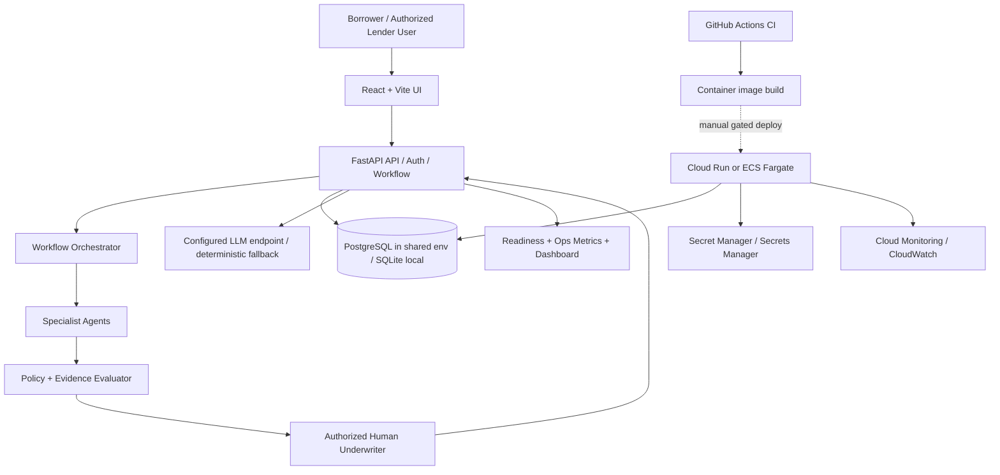

# CygnusX-1 system architecture

## Purpose and boundary

CygnusX-1 is a workflow and decision-support prototype for the U.S. SBA 7(a)/504 loan lifecycle. It is **not** an SBA-certified platform, lender-of-record, credit bureau, identity-verification service, legal opinion, or automated credit authority. SBA program requirements are principally administered by the U.S. Small Business Administration (SBA), not the SEC. SEC rules become relevant only where the actual business model or instruments create a securities-law nexus. Compliance counsel and the lender's compliance owner must determine applicability.

## Logical architecture

## Layers and responsibilities

| Layer | Responsibility | Required controls |
| --- | --- | --- |
| Experience | Borrower/lender screens and stage progression | Accessible UI, safe error messages, no secrets in browser bundles |
| API / identity | Request validation, session lifecycle, authorization boundary | TLS at ingress, secure cookies, CSRF review, rate limits, session revocation, least privilege |
| Workflow | Lifecycle state, required evidence, stage transitions | Explicit state machine, idempotency, controlled overrides, immutable audit trail |
| Agent orchestration | Specialist analysis, summarization, evidence extraction | Narrow tools, typed inputs/outputs, bounded retries/timeouts, no autonomous final approval |
| Policy/evidence | SBA program rules, lender overlays, source citations, exceptions | Versioned rules with effective dates, source provenance, fail-closed missing evidence |
| Human credit authority | Final credit decision and exceptions | Named approver, recorded rationale, segregation of duties, override capture |
| Persistence | Applications, parties, evidence metadata, decisions, audit events | Versioned migrations, tenant/record authorization, encryption, retention/deletion policy, backup restore tests |
| Integration | Credit, identity, sanctions, document, e-sign and SBA/lender systems | Approved providers, lawful purpose/consent, secrets, retries, reconciliation and vendor due diligence |
| Operations | Health, readiness, dashboard and alerting | Protected metrics, centralized logs, fleet-wide monitoring, SLOs and incident runbooks |
| Delivery | CI, image build, gated deployment | Protected branches, least-privilege OIDC, artifact provenance, scanning, approval before production |

## Key trust boundaries

1. Browser input is untrusted. Validate at the API and re-authorize every record operation server-side.
2. Uploaded documents and retrieved content are untrusted data, never instructions to an agent. Use prompt-injection defenses, file-type/size limits, malware scanning, and PII-aware logs.
3. LLM output is a recommendation, not policy truth. Require schema validation, evidence references, deterministic policy checks, and human approval for credit decisions.
4. External credit, identity, sanctions and SBA/lender systems are provider boundaries. Do not simulate successful verification in production.
5. Local SQLite and development identity settings are for development only. Production must use managed PostgreSQL, real identity/verification, TLS, and a reviewed authorization model.

## Recommended deployment topology

- **Laptop:** Vite UI on 8080, FastAPI on 8000, SQLite by default; optional Docker Compose with PostgreSQL.
- **Shared test:** private API service, managed PostgreSQL, secret manager, centralized logs, synthetic/test data.
- **Production candidate:** private network/database, HTTPS ingress, workload identity/OIDC, WAF/rate limiting, managed secrets, backups/PITR, alerts, vulnerability scanning, formal change approval and documented recovery test.

The current Cloud Run/ECS workflows deploy the API/dashboard container only. Frontend hosting and its authenticated production build are separate deployment work.

## Architecture decisions / non-goals

- The underwriter scorecard is advisory; a designated human owns final approval.
- No direct claim is made that the application is compliant with SBA, ECOA/Reg B, FCRA, BSA/AML, privacy, or securities laws merely because workflow stages exist.
- No real borrower data should be used until access controls, data handling, retention, provider contracts, auditability, and security testing have been reviewed.
